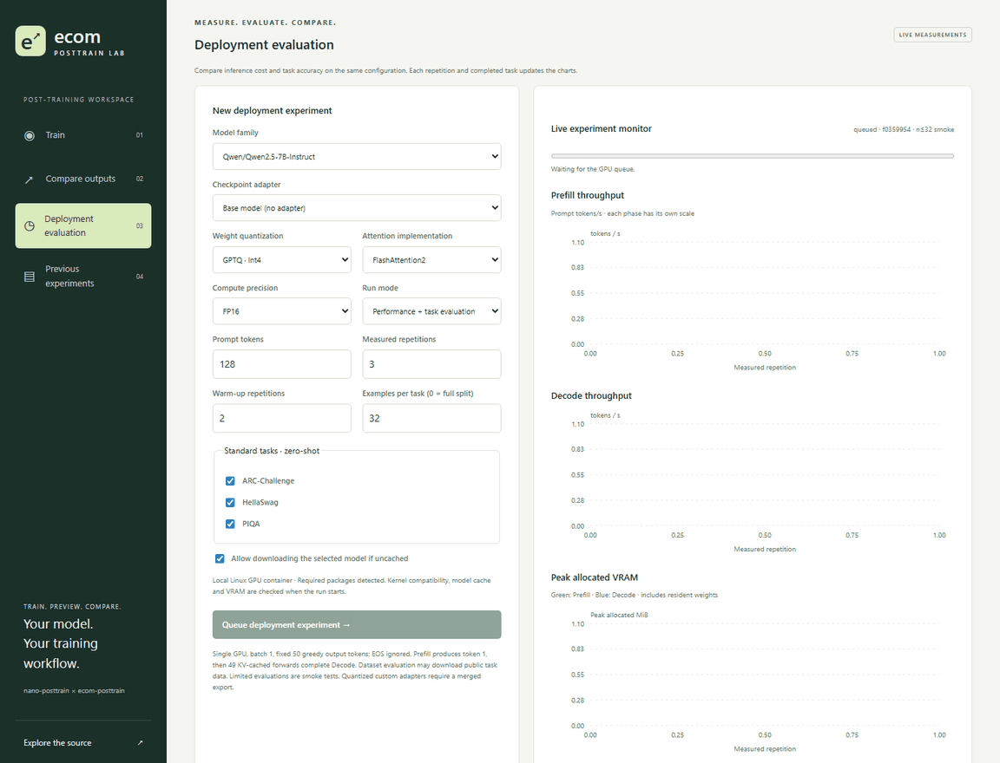
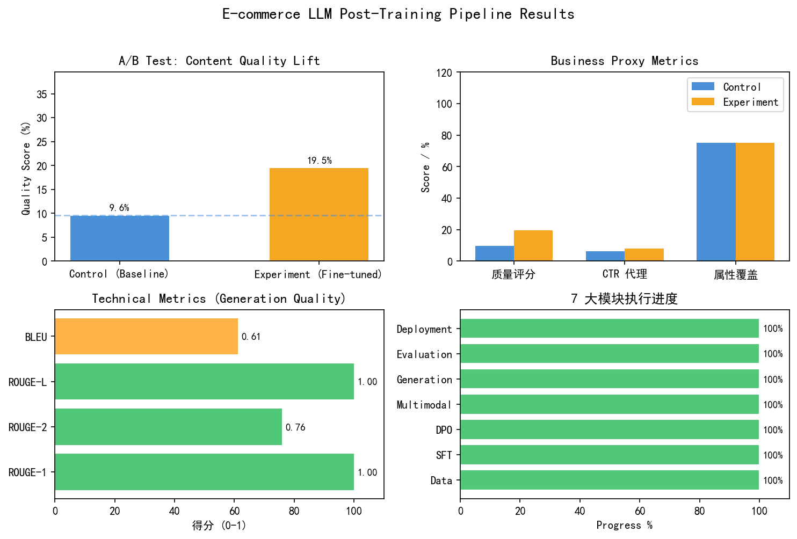

# ecom-posttrain

An e-commerce post-training demo built on [nano-posttrain](https://github.com/AMark-CS/nano-posttrain): synthetic data preparation, SFT, DPO, experimental GRPO, content filtering, task evaluation and local GPU deployment experiments.

The training wrappers and companion live lab execute real PyTorch training and inference. The legacy generation, evaluation, performance and multimodal demo commands contain simulations; those reports do not establish model quality, business lift or serving performance.

## Live workspace demo



Recorded on **2026-10-22 on the local RTX 3060 (8 GiB)** through a dedicated Linux container. The real `Qwen2.5-7B-Instruct-GPTQ-Int4` experiment uses FP16 computation, FlashAttention2, three measured repetitions after two warm-ups, and ARC-Challenge/HellaSwag/PIQA with 32 examples each. The 16-second looping GIF samples and shortens the actual run; it is a workflow recording, not a latency benchmark. [Earlier SFT training/generation recording](docs/images/live-workspace.gif).

## Verified results

Verified locally on **2026-10-20**, using Windows, Python 3.12.14, PyTorch 2.11.0+cu128, Transformers 5.19.0, and an NVIDIA GeForce RTX 3060. Model: `Qwen/Qwen2.5-0.5B`; LoRA rank 16, alpha 32, dropout 0.05; bfloat16. The model was already cached.

| Check | Observed result | Interpretation |
| --- | --- | --- |
| Data artifacts | 360 products; 182 Chinese / 178 English; 0 rejected | Synthetic fixtures, not a production quality estimate |
| SFT splits | 918 train / 108 validation / 54 test | Three tasks per product |
| Preference and multimodal splits | 306 / 36 / 18 each | Checked against existing files |
| SFT wrapper | Two optimizer steps completed; adapter saved to `output/readme_sft/step_latest/lora.pt` | Execution check, not convergence |
| DPO wrapper | Two optimizer steps completed with CPU reference; adapter saved to `output/readme_dpo/latest/lora.pt` | Historical cross-device label failure did not recur |
| LoRA parameters | 11,243,520 / 505,276,288 (2.23%); 169 wrapped modules | Observed in training logs |
| Product overlap | 93/95 validation products and 51/52 test products also appear in SFT training | Current splits leak product identity |

Training checks used batch size 1, gradient accumulation 1, maximum sequence length 128, and two steps; DPO used maximum prompt length 64, beta 0.1, gamma 0.1, and a CPU reference. These are independent runs from the base model: DPO does **not** load the SFT adapter. No held-out quality improvement was measured.

### Results chart



The chart separates artifact inspection, real training execution, and template-demo results. It does not report held-out model quality. [Source reports](docs/verification/README.md) and [chart generator](docs/generate_readme_charts.py) are retained; rebuild with `python docs/generate_readme_charts.py` (Matplotlib required).

### Reproduced simulation outputs

Reports and reproduction commands are in [docs/verification](docs/verification/README.md).

| Demo | Output | Limitation |
| --- | --- | --- |
| Evaluation, 54 examples | ROUGE-1 1.0000; ROUGE-2 0.7593; ROUGE-L 1.0000; BLEU 0.6111 | References are copied into predictions; whitespace tokenization and short texts explain non-perfect higher-order scores |
| Template comparison, 20 items per group | Quality proxy 0.09583 → 0.19533 (+103.8%); simulated CTR 0.064 → 0.079 (+23.4%) | Hard-coded templates; CTR is `round(0.05 + quality * 0.15, 3)`, with no click data |
| Attribute coverage | 0.75 in both template groups | No coverage gain |
| Content filter | Baseline: 100% pass; tuned: 5% pass, 95% warn; both: 0% block | Numeric checks can confuse sales counts with prices; warnings need investigation |
| Performance formula | p50/p95/p99 318/348/348 ms; 825 tokens/s; 164.94 requests/s; 3300 MB | Arithmetic constants; no endpoint requests or GPU-memory measurement |

The historical GRPO claim (six steps, 288.1 seconds, reward mean/max 0.688/0.798) has no retained training log or checkpoint in this checkout. It is excluded from measured results. That historical run is not reclassified as evidence; a separate verified GRPO implementation check is documented below. The old summary chart is not used as evidence.

## Live deployment evaluation

The companion local lab now calls `ecom_posttrain.deployment.live_evaluation` for real Prefill/Decode measurements and ARC-Challenge, HellaSwag and PIQA through EleutherAI LM Evaluation Harness. Its Deployment evaluation panel plots per-repetition throughput/peak VRAM, per-task `acc`/`acc_norm`, and completed configurations on a memory/throughput chart. Runs preserve their model revision, adapter, actual attention implementation, quantization metadata, environment and protocol. This measured path is separate from the legacy formula-based `deployment/benchmark.py` command.

Install the optional harness with `python -m pip install -e '.[evaluation]'` in a compatible environment. Supported configuration choices include Qwen2.5-0.5B/7B, official Instruct AWQ/GPTQ Int4/Int8 weights, FP16/BF16, eager/SDPA/FlashAttention2. The selected quantized backend or attention kernel must actually be installed and compatible; failures never silently fall back to another method. Existing custom adapters support unquantized evaluation, while their quantization requires a merged and calibrated export.

The benchmark uses batch one, warm-up, exact prompt-token counts and 50 greedy output tokens, with EOS ignored. Prefill produces token one; Decode measures the remaining 49 KV-cached forwards. The reported output throughput is 50 divided by that Decode interval, with this boundary retained explicitly. CUDA peak allocated/reserved memory and load peak are recorded. Task evaluation is zero-shot, no chat template, maximum length 2048, with matching seeds and effective sample counts. Limited runs are smoke tests; full splits must be selected for benchmark reporting. Performance deltas require matching protocols/hardware; no original AutoDL percentage claim is copied into these results.

The initial native Windows checks covered 0.5B SDPA/Eager, an existing SFT adapter, live charts/restoration and cancellation; those [earlier receipts](docs/verification/deployment_2026-10-22.json) are retained. The local 0.5B/7B quantization and FlashAttention2 experiment matrix below supersedes the earlier unverified status. AutoDL was not used.

### Local RTX 3060 8-GiB experiments

Measured locally with FP16 computation, batch 1, 128 prompt tokens, 50 greedy output tokens, two warm-ups and three measured repetitions. Task columns are **raw `acc`**, each on the first **32 examples**, zero-shot with no chat template. All models are the official **Instruct** variants. Decode uses the boundary documented above.

| Model | Weights / attention | Prefill tok/s | Decode output tok/s | Peak CUDA MiB | ARC acc | HellaSwag acc | PIQA acc |
| --- | --- | ---: | ---: | ---: | ---: | ---: | ---: |
| 7B | AWQ Int4 / SDPA | 639.13 | 15.08 | 5,379 | 50.00% | 62.50% | 81.25% |
| 7B | GPTQ Int4 / SDPA | 1414.05 | 27.36 | 5,395 | 50.00% | 62.50% | 87.50% |
| 7B | GPTQ Int4 / FA2 | 875.34 | 14.50 | 5,394 | 50.00% | 62.50% | 87.50% |
| 0.5B | FP16 / SDPA | 4184.95 | 42.20 | 961 | 25.00% | 43.75% | 71.88% |
| 0.5B | FP16 / FA2 | 2341.73 | 20.44 | 961 | 25.00% | 43.75% | 71.88% |
| 0.5B | AWQ Int4 / SDPA | 1894.58 | 18.60 | 706 | 34.38% | 43.75% | 71.88% |
| 0.5B | GPTQ Int4 / SDPA | 4209.81 | 37.46 | 454 | 21.88% | 43.75% | 75.00% |
| 0.5B | GPTQ Int8 / SDPA | 3082.29 | 37.79 | 627 | 25.00% | 43.75% | 71.88% |
| 7B | GPTQ Int8 (partial, oversubscribed) / SDPA | 53.41 | 2.86 | 8,504† | not completed | not completed | not completed |
| 7B | FP16 (preflight rejected) / SDPA | — | — | — | — | — | — |

The 0.5B GPTQ Int4 run reduced peak CUDA allocation by **52.81%** relative to the matched FP16/SDPA run. None of the tested optimized 0.5B configurations beat that baseline's Decode output throughput in this small workload. FlashAttention2 was slower for these short requests; it is not presented as an automatic speedup. Accuracy differences on 32 examples are smoke observations, not evidence that quantization improves or preserves general task quality.

† 7B Int8 allocated about 8,504 MiB on an 8,192-MiB GPU and slowed to about 2.86 output tokens/s. The run was stopped during task evaluation; its three measured repetitions are retained, with no completed accuracy claim. This allocation exceeds physical capacity and is consistent with [system-memory fallback](https://nvidia.custhelp.com/app/answers/detail/a_id/5490), whose transfer/residency behavior was not directly profiled. The platform now flags oversubscription and rejects it from resident-GPU evaluation. 7B FP16 was rejected before loading: checkpoint weights alone require **14.19 GiB**, exceeding 8 GiB. No explicit CPU offload or replacement quantization was applied.

[Complete configurations, raw observations, task counts, kernel classes, versions and failure reasons](docs/verification/local_3060_2026-10-22.json). Successful GPTQ runs used Marlin; AWQ used Triton. The local runtime pins Python 3.11, Torch 2.8.0+cu128, Transformers 4.56.2, GPTQModel 4.2.5, AutoAWQ 0.2.9 and FlashAttention2 2.8.3.post1. These results do not reuse the historical AutoDL improvement percentages.


## Installation

Run from the repository root. Install a PyTorch build appropriate for your hardware first.

```bash
python -m pip install -e ../nano-posttrain
python -m pip install -e . --no-deps
python -m pip install -r requirements.txt
```

For a standalone checkout, install the core with `python -m pip install git+https://github.com/AMark-CS/nano-posttrain.git` instead of the sibling editable install. Project documentation is in English; Chinese/English fixtures and task templates are retained for bilingual experiments.

## Reproduce the training checks

```bash
python -m ecom_posttrain.model.sft_train \
  --data_path dataset/processed/sft_train.jsonl \
  --output_dir output/readme_sft --max_steps 2 --max_length 128 \
  --per_device_batch_size 1 --grad_accum_steps 1

python -m ecom_posttrain.model.dpo_train \
  --data_path dataset/processed/preference_train.jsonl \
  --output_dir output/readme_dpo --max_steps 2 --max_length 128 \
  --max_prompt_length 64 --per_device_batch_size 1 --grad_accum_steps 1 \
  --ref_device cpu --beta 0.1 --gamma 0.1
```

Set `WANDB_DISABLED=1` to avoid optional tracking. Set `HF_HUB_OFFLINE=1` only when the model is cached; environment-variable syntax varies by shell.

Use package-qualified modules such as `python -m ecom_posttrain.data.prepare_data --help`. The current `run_pipeline.py` invokes old unqualified modules (`data.*`, `model.*`, etc.), continues after subprocess failures, and writes a completion summary regardless of success. Its exit code and summary are not proof of an end-to-end run.

## Optimization priorities

| Priority | Evidence and proposed change | Acceptance check |
| --- | --- | --- |
| P0: actual model evaluation | Replace reference copying and template generation with base/SFT/DPO inference on identical prompts; retain outputs and checkpoint identities | Recompute metrics from saved predictions; report language/task breakdown, factuality, sample counts, and uncertainty |
| P0: prevent leakage | Split by product ID before expanding tasks or preference pairs; current test overlap is 51/52 products | Assert disjoint product IDs and inspect duplicate text/image identities |
| Fixed: GRPO objective (2026-10-21) | Response labels and exact generated token IDs now define the policy objective; the nonnegative KL estimator keeps policy gradients | Gradient/masking/clipping tests, actual DPO-initialized updates, checkpoint generation and cancellation passed; see the GRPO section |
| P1: connect training stages | The legacy DPO pipeline starts from base; the GRPO stage now targets the actual SFT `step_latest` artifact | Load the intended policy adapter/reference and verify checkpoint identities |
| P1: reliable orchestration | Old module names, mixed artifact locations, unconditional success reporting | Use package-qualified modules and one artifact root; propagate required-stage failures |
| P1: factuality filtering | Tuned templates produce 19 warnings out of 20; sources are joined by position | Join by product ID; extract prices, sales, and ratings separately; measure false positives and missed errors |
| P1: bilingual metrics | Whitespace tokenization and length-based quality proxies distort scores | Use validated language-aware tokenization and blinded factuality/usefulness review |
| P2: real serving benchmark | Benchmark values come from formulas; deployment scripts generate configuration | Test a running endpoint with warm-up, output-token counts, concurrency, latency distributions, and measured peak memory |
| P2: multimodal and export validation | Alignment uses random features; adapter directories are not full Hugging Face models | Add real image encoders and image-disjoint evaluation; merge/export adapters and validate quantized quality/loadability |

These are proposed improvements, not implemented fixes. Establish valid splits and inference evaluation before tuning training duration or throughput.

## Layout and documentation

- `ecom_posttrain/data/`: synthetic data preparation, cleaning, tagging, splitting.
- `ecom_posttrain/model/`: SFT/DPO wrappers, experimental GRPO, rule rewards, multimodal demonstration.
- `ecom_posttrain/generation/`: template generation, filtering, post-processing.
- `ecom_posttrain/evaluation/`: illustrative metrics, simulated A/B comparison, monitoring scaffolding.
- `ecom_posttrain/deployment/`: serving configuration, quantization helpers, simulated benchmark.
- [Project notes](docs/project_readme.md), [technical design](docs/technical_design.md), [experiment design](docs/ab_test_design.md), [verification](docs/verification/README.md).
- [Software engineering design review](docs/software_engineering_review.md): boundaries, correctness, testing, security, performance, and a prioritized improvement sequence using the Agent Skills workflow.


## GRPO training

GRPO is implemented in this application layer and reuses nano-posttrain model, reference and LoRA helpers. The local companion lab at `../sites/ecom-posttrain-lab` exposes it under Method → GRPO. The standalone command is:

```bash
python -m ecom_posttrain.model.grpo_train --model_name Qwen/Qwen2.5-0.5B --data_path dataset/processed/preference_train.jsonl --model_path output/readme_dpo/latest --output_dir output/grpo_verified --max_steps 3 --group_size 4 --prompts_per_step 1 --max_examples 8 --max_length 128 --max_prompt_length 64 --max_new_tokens 24 --learning_rate 1e-5 --kl_beta 0.02
```

The selected checkpoint must exist and match the configured base model and LoRA rank/alpha; remove `--model_path` to start from base. Both policy and frozen reference restore that initial adapter. The CLI rejects the old unimplemented `model_based` reward option; the implemented reward is the existing e-commerce rule heuristic plus group diversity.

The original sequence-normalized GRPO objective uses group-standardized rewards, an on-policy probability-ratio surrogate and the differentiable estimator `exp(logp_ref-logp_policy) - (logp_ref-logp_policy) - 1`. Policy gradients pass through the KL term. The trainer performs one update per fresh rollout batch, with dropout disabled, scoring temperature matched to rollout temperature, and exact generated tokens replayed through response-only labels. EOS is included once; post-EOS padding and prompt tokens are excluded. Sequence micro-batches limit memory while preserving equal-sequence normalization. Clipping is inactive on a single fresh-policy update; the standalone loss accepts explicit old-policy values and verifies clipping independently. Reference weights remain frozen. See [TRL's GRPO objective](https://huggingface.co/docs/trl/grpo_trainer#computing-the-loss).

`on_step`, `on_phase` and `should_stop` callbacks support live optimizer metrics, rollout/backpropagation progress and cooperative cancellation. Receipts report completed updates, rule reward mean/min/max, KL, advantages and flat groups. Partial accumulation is discarded on cancellation. A flat-reward group supplies zero relative reward advantage; no fake improvement is reported. The CLI retains `latest/lora.pt`, `grpo_history.json` and an actual-step report. The lab additionally saves immutable step adapters and exposes checkpoint generation.

The retained [2026-10-21 verification](docs/verification/grpo_2026-10-21.json) records three real updates initialized from the existing DPO smoke adapter, 12 completions, checkpoint generation and cancellation preserving a completed update. Training elapsed time was 52.540 seconds and peak allocated VRAM was 1,313.9 MiB on the local RTX 3060 8GB. Reward means were 0.6381 → 0.7423 → 0.6866; all 338 adapter tensors changed and remained finite. These are execution checks, not convergence, human preference or CTR evidence. The seven GRPO unit tests run with `python -m unittest discover -s tests -v` in an environment containing the project and nano-posttrain dependencies.
